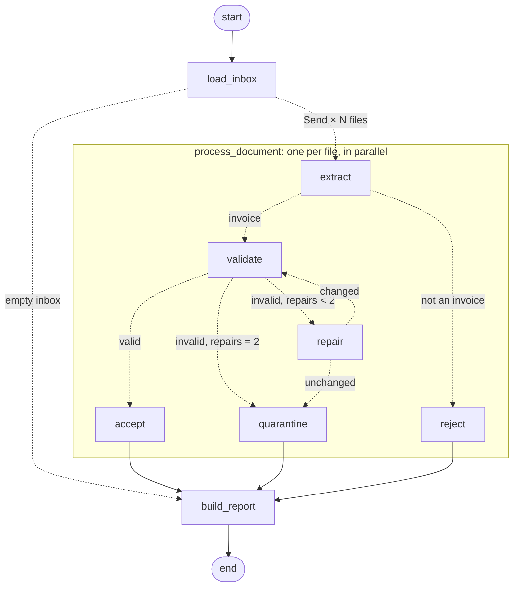

# Invoice extraction pipeline with parallel fan-out, repair loop and quarantine (LangGraph)

Drop documents into `inbox/`. The pipeline extracts every one **in parallel** with an LLM,
validates each extraction **in plain code**, and lets the model repair its own mistakes,
up to twice. It quarantines anything that still doesn't check out, then catches duplicates
across the whole batch. A wrong number never reaches the accepted pile, even when the
document itself is wrong.

Python · LangGraph · LangChain · OpenAI · ~255 lines of pipeline code plus a 90-line CLI.

```bash
cp .env.example .env        # add OPENAI_API_KEY
uv run run.py               # processes the six sample documents in inbox/
```

`uv run pytest` runs 14 offline tests and needs no API key.

## Graph

Two graphs. The batch graph fans out one `Send` per file to a compiled per-document
subgraph. LangGraph runs those in parallel, and a reducer on `results` collects them:



| Node | What it does | LLM? |
|---|---|---|
| `load_inbox` | Reads `*.txt` from the inbox | no |
| `extract` | Structured output into a Pydantic `Extraction` (vendor, number, date, currency, line items, subtotal, tax, total) | yes |
| `validate` | [invoice_pipeline/validate.py](invoice_pipeline/validate.py): arithmetic and provenance checks | **no** |
| `repair` | Re-extracts, with the previous extraction and the exact failed checks as feedback | yes |
| `accept` / `quarantine` / `reject` | Write one `DocResult` into the batch's `results` | no |
| `build_report` | Fan-in: duplicates, counts, totals per currency | no |

State is typed at both levels ([invoice_pipeline/state.py](invoice_pipeline/state.py)):
`DocState` inside the subgraph, and `BatchState` with
`results: Annotated[list[DocResult], operator.add]` so parallel branches append instead of
overwriting. The subgraph has an `output_schema`, so only `results` crosses back into the parent.

## Why validation is code, and why it checks provenance

Arithmetic checks alone (lines sum to subtotal, subtotal + tax = total) have a trap. If the
repair step is told "your numbers don't add up", the easiest way for a model to pass is to
*change the numbers until they do*. So the validator also checks that every amount, the
invoice number and the vendor are **actually printed in the document**. It accepts `1,204.50`,
`1204.50` and `1.204,50`, and is boundary-aware, so `204.50` doesn't match inside `1,204.50`.
A repair can fix a misread field. It can't invent a subtotal.

The repair prompt says the same thing: *if the document itself is inconsistent, keep the
printed values*. If a repair returns exactly what it returned before, the loop stops
straight away and quarantines. A second identical answer isn't worth paying for.

## The sample inbox

| File | What's in it | Result |
|---|---|---|
| `northwind-INV-1043.txt` | Clean US invoice | accepted |
| `harbor-print-7781.txt` | UK layout: "Net amount / VAT @ 20% / Amount due" | accepted (repaired, if the model takes "Net amount" as the total) |
| `alpine-cloud-AC-0099.txt` | German invoice, `1.204,50 €`, date `03.10.2026` | accepted |
| `ridgeway-RL-2207.txt` | Line items sum to 2,150.00 but the printed subtotal is 2,250.00 | **quarantined**: the document is wrong, not the extraction |
| `reminder-northwind-INV-1043.txt` | A payment reminder containing a copy of INV-1043 | **quarantined** as a duplicate in `build_report` |
| `delivery-note-5512.txt` | Delivery note, no prices | **rejected**: not an invoice |

Duplicates can only be caught at fan-in, after every branch is done. The report sorts by file
name first, so its contents don't depend on which parallel branch finished first.

## Failure handling

- **Bad extraction:** validate → repair with the precise failed checks → validate. Bounded at 2
  repairs, with an early exit when a repair changes nothing.
- **Bad document:** quarantined with the reasons, for a person to look at. Never silently "fixed".
- **Transient LLM errors:** `RetryPolicy` on `extract` and `repair`.
- **The batch crashes halfway** (API outage, deploy, laptop lid): every step is checkpointed to
  SQLite. `uv run run.py --resume RUN_ID` re-runs only the documents that hadn't finished.
  Branches that completed before the crash are not re-extracted, and a test asserts it.

## Example run

Real output from `uv run run.py` (OpenAI `gpt-4.1-mini`). Here the model read Harbor's
"Amount due" correctly on the first pass, so only Ridgeway went through the repair loop.

```text
$ uv run run.py
run run-58d055a7: processing inbox/ (resume with --resume run-58d055a7 if it stops)

── load_inbox
  delivery-note-5512.txt             extract     not an invoice
  delivery-note-5512.txt             reject      rejected (not an invoice)
  alpine-cloud-AC-0099.txt           extract     Alpine Cloud GmbH | AC-0099 | 2 lines | 1,433.36 EUR
  alpine-cloud-AC-0099.txt           validate    valid
  alpine-cloud-AC-0099.txt           accept      accepted
  northwind-INV-1043.txt             extract     NORTHWIND OFFICE SUPPLY | INV-1043 | 3 lines | 1,274.40 USD
  northwind-INV-1043.txt             validate    valid
  northwind-INV-1043.txt             accept      accepted
  ridgeway-RL-2207.txt               extract     RIDGEWAY LOGISTICS | RL-2207 | 3 lines | 2,475.00 EUR
  ridgeway-RL-2207.txt               validate    1 failed: line items sum to 2,150.00 but subtotal is 2,250.00
  harbor-print-7781.txt              extract     Harbor Print Co. | 7781 | 2 lines | 768.00 GBP
  harbor-print-7781.txt              validate    valid
  harbor-print-7781.txt              accept      accepted
  reminder-northwind-INV-1043.txt    extract     NORTHWIND OFFICE SUPPLY | INV-1043 | 3 lines | 1,274.40 USD
  reminder-northwind-INV-1043.txt    validate    valid
  reminder-northwind-INV-1043.txt    accept      accepted
  ridgeway-RL-2207.txt               repair      attempt 1, changed=False: RIDGEWAY LOGISTICS | RL-2207 | 3 lines | 2,475.00 EUR
  ridgeway-RL-2207.txt               quarantine  quarantined (repair returned the same values: inconsistent as printed)
── build_report

══ report [run-58d055a7]
  alpine-cloud-AC-0099.txt           accepted     repairs=0  AC-0099  1,433.36 EUR
  delivery-note-5512.txt             rejected     repairs=0  
                                     └ not an invoice
  harbor-print-7781.txt              accepted     repairs=0  7781  768.00 GBP
  northwind-INV-1043.txt             accepted     repairs=0  INV-1043  1,274.40 USD
  reminder-northwind-INV-1043.txt    quarantined  repairs=0  INV-1043  1,274.40 USD
                                     └ duplicate of northwind-INV-1043.txt
  ridgeway-RL-2207.txt               quarantined  repairs=1  RL-2207  2,475.00 EUR
                                     └ line items sum to 2,150.00 but subtotal is 2,250.00; repair returned the same values: inconsistent as printed
  counts: {'accepted': 3, 'rejected': 1, 'quarantined': 2}   accepted totals: {'EUR': 1433.36, 'GBP': 768.0, 'USD': 1274.4}
```

Lines from different documents interleave in the output because they really are processed
in parallel.

## Tests

14 offline tests (a scripted LLM keyed by file, the real `inbox/`), covering:

- the whole inbox sorted into accepted / quarantined / rejected, with totals per currency;
- a misread total repaired on the first attempt;
- an inconsistent invoice stopping after one unchanged repair (2 LLM calls, not 3);
- a repair that fudges the subtotal to make the arithmetic work, which is still quarantined because the fudged numbers aren't printed;
- an empty inbox; report independence from completion order;
- a batch that crashes on one document, then resumes from SQLite without redoing the other five;
- validator edge cases: EU number format, number boundaries, invented invoice number, lowercase currency, future date, renamed vendor.
